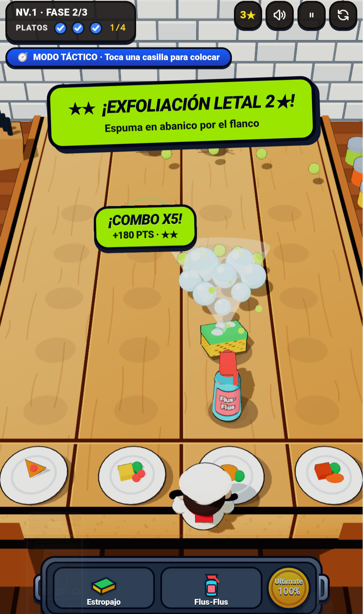
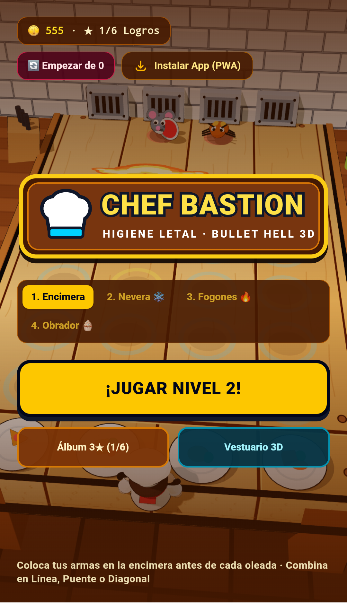
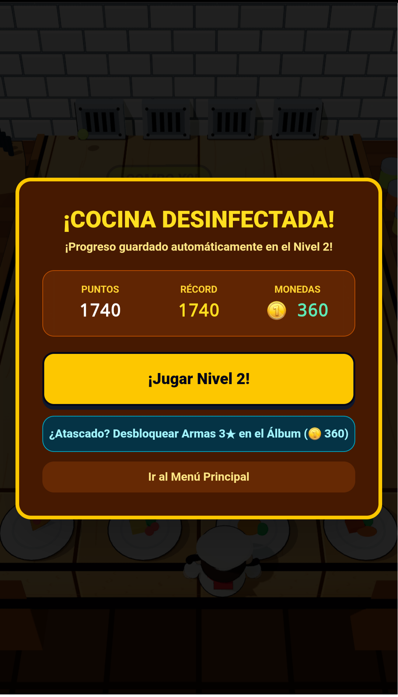
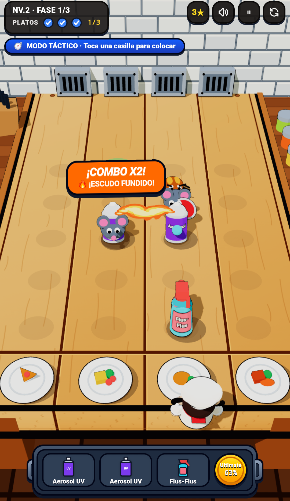

# 👨‍🍳 CHEF BASTION: Higiene Letal 3D
### Documento Técnico, de Producto y Arquitectura Interna del Estudio

**Chef Bastion: Higiene Letal 3D** es un videojuego *Mobile-First (9:16)* y *100% Offline-First* de defensa táctica por raíles, *Bullet-Hell* de desinfección y puzles espaciales en tiempo real. Está construido íntegramente sobre tecnologías web nativas (**React 19 + TypeScript + Three.js WebGL + Web Audio API + VitePWA / Capacitor**) sin depender de motores pesados externos, servidores backend ni activos multimedia de terceros.

---

## 📸 Galería Oficial del Juego (Capturas Reales en 9:16)

| 1. Pantalla de Título y Mundos | 2. Combo en Línea (`¡Combo x5!` · 2★) | 3. Puente de Fuego UV (`¡Escudo Fundido!`) | 4. Victoria y Progresión Automática |
| :---: | :---: | :---: | :---: |
|  |  |  |  |
| *Selector de mundos, Álbum 3★, Vestuario 3D e instalación PWA/APK* | *Flus-Flus + Estropajo proyectando cono y pompas 3D hacia las plagas* | *2 Aerosoles UV conectados en paralelo fundiendo el escudo rojo* | *Resumen de puntos, récord, monedas y acceso directo al Álbum 3★* |

---

## 🧭 1. Necesidad del Proyecto y Visión de Diseño (¿Por qué y para qué nace?)

### 1.1. El Problema en los Juegos Móviles de Defensa Actuales
1. **El síndrome del "Piloto Automático"**: En la mayoría de *Tower Defense* móviles, una vez colocadas las torres, el juego se juega solo. El jugador pasa a ser un espectador pasivo esperando a que termine la oleada.
2. **Interfaces sobrecargadas e incómodas en vertical**: Muchos títulos portan interfaces de PC llenas de menús flotantes, árboles de estadísticas oscuros y botones diminutos que tapan la acción o exigen jugar con dos manos en horizontal.
3. **Dependencia de conexión y descargas pesadas**: Juegos casuales que requieren decenas de megabytes en texturas/sonidos externos y conexión permanente a servidores.

### 1.2. La Solución de *Chef Bastion*
*Chef Bastion* nace de la necesidad de crear un juego táctico **inmediato, rejugable, 100% controlable con un solo pulgar en pantalla vertical (9:16)** y con acabado visual de estudio indie (*Cel-Shading* ilustrado con contorno de tinta negra), bajo tres pilares inquebrantables:
- **Cero Piloto Automático**: La encimera empieza siempre **100% vacía** y ninguna pieza sola gana la partida; el jugador debe **conectar utensilios entre sí** (en línea, en paralelo o en diagonal) y reubicarlos en caliente según el tipo de plaga que asome por los conductos.
- **Claridad Visual Absoluta**: Cero números flotantes de daño genéricos; toda la información es diegética (4 platos de porcelana reales con comida 3D como vidas, armaduras rojas visibles en las ratas, moco verde sobre armas bloqueadas, chorros de fuego y abanicos de pompas 3D).
- **Arquitectura 100% Autónoma (*Zero-External-Assets*)**: Todos los modelos 3D, texturas de madera/azulejos y efectos de sonido se generan matemáticamente por código en tiempo de ejecución. El juego arranca en milisegundos y funciona en modo avión dentro de un `.apk` o PWA.

---

## 🎮 2. ¿De Qué Va el Juego y Qué Hace Exactamente? (Mecánicas al Detalle)

### 2.1. Escenario y Narrativa Visual
El jugador encarna a **Chef Bastion**, un chef de alta cocina que defiende el pase de emplatado de su restaurante frente a una invasión coordinada de plagas (cucarachas corredoras, ratas acorazadas con escudos de chapa, moscas ácidas escupidoras y el Rey Rata).
- **Arriba (`z = -6.28`)**: Pared de azulejos blancos de cocina con **4 rejillas rectangulares de ventilación de acero** (una por cada raíl).
- **Centro (`z = -5.00` a `+2.92`)**: Encimera de carnicero de madera de arce dividida en **4 tablones verticales (4 raíles) × 7 filas**.
  - **Filas 1 y 2 (`row = 0, 1`)**: Zona roja prohibida de emergencia de plagas (no se permite colocar utensilios encima de las rejillas).
  - **Filas 3 a 7 (`row = 2..6`)**: **20 casillas tácticas jugables** grabadas sutilmente en la madera (`0.08` de opacidad en reposo), donde el jugador despliega y reordena sus armas.
- **Línea del Bastión (`z = +4.18`)**: Separada del área de combate por una hendidura tallada en la madera, contiene los **4 Platos Gourmet de Porcelana Blanca** (tarta con fresa, polenta con tomates cherry y brócoli, asado dorado y pastel de carne).
- **Frente de la Mesa (`z = +4.72`)**: El **Chef Bastion** visto en perspectiva 3/4 trasera, moviéndose lateralmente al raíl donde el jugador interactúa y reaccionando con animaciones cuando logra un combo o pierde un plato.
- **Bandeja Metálica Inferior (UI)**: Bandeja de acero pavonado con asas laterales donde descansan las piezas al iniciar el nivel y el botón circular dorado de la habilidad **Ultimate**.

---

### 2.2. Flujo de una Partida (*Core Loop*)

1. **Fase de Preparación (`PREP` — Tablero 100% Vacío)**:
   - Al arrancar cualquier nivel, **todas las piezas están en la bandeja inferior** (`rail: null, row: null`).
   - Las primeras plagas se asoman por las rejillas superiores (`yProgress = -0.35`) mostrando claramente por qué raíles van a bajar y si llevan escudo rojo, pero **no avanzan** hasta que el jugador coloca sus armas en la encimera (o pulsa `▶️ ¡EMPEZAR!`).
   - En los **Niveles 1 a 3**, un **Tutorial Guiado Paso a Paso** ilumina con anillos pulsantes las casillas exactas para enseñar al jugador a construir cada uno de los 3 combos espaciales sin texto abrumador.

2. **Fase de Oleada Activa y los 3 Cambios de Ritmo (`Fase 1/3 → 2/3 → 3/3`)**:
   - Cada nivel consta de **3 fases** con objetivos de desinfección crecientes (`4`, `6` y `8` bajas base escaladas por nivel).
   - Al completar la Fase 1 y la Fase 2, se activa un **respiro táctico de 3 segundos (`prepTimer`)** con aviso de conductos para que el jugador reorganice sus piezas antes de la siguiente embestida.
   - En la **Fase 3/3**, irrumpe el jefe de oleada (**Rey Rata con Corona Dorada**) escoltado por plagas blindadas.

3. **Modo Táctico Slow-Mo (20%) y *Grid On-Demand***:
   - Si en mitad del frenesí de una oleada una rata blindada avanza por un carril desprotegido, el jugador puede tocar cualquier utensilio de la encimera o de la bandeja:
     - El tiempo de simulación se reduce instantáneamente al **20% (`timeScale = 0.2`)**.
     - Las casillas válidas de la madera se iluminan (*Grid On-Demand*) y una **previsualización holográfica 3D** muestra qué combo se activará en la casilla destino.
     - Si el jugador suelta un utensilio sobre otro ya colocado, **ambos intercambian su posición instantáneamente (*Direct Swap*)** sin pasos intermedios.

4. **Los 4 Platos y los 3 Sellos de Sanidad**:
   - Cuando una plaga supera la Fila 7 y alcanza los platos (`yProgress >= 6.55`), devora la comida del plato de ese raíl y el jugador pierde **1 Sello de Sanidad (✓ azul)**.
   - Al perder los 3 sellos, Sanidad clausura la cocina (*Game Over*), mostrando una pantalla de **Casi Victoria (*Near-Miss*)** que indica exactamente cuántas plagas faltaron para superar la fase.

---

### 2.3. Arsenal de Utensilios y Sistema de Combos Espaciales

El núcleo estratégico del juego reside en cómo interactúan las piezas cuando se colocan adyacentes en el tablero (`evaluateBoardCombos` en `src/game/rules.ts`):

| Utensilio | Comportamiento Individual | Sinergia / Receta de Combo | Efecto del Combo Conectado |
| :--- | :--- | :--- | :--- |
| **🔫 Spray Flus-Flus** (`spray_flus`) | Dispara gotas rápidas de limpiador hacia arriba (`-Z`) en su raíl. | **Combo en Línea (`line_foam`)**: Colocar el *Flus-Flus* **justo detrás** de un *Estropajo* en el mismo raíl. | Empapa el estropajo y proyecta un **cono de espuma 3D con pompas blancas** y una ráfaga en **abanico de 5 proyectiles** (`×5`) que ralentiza y barre múltiples carriles. |
| **🧽 Estropajo Nanas** (`scourer_nanas`) | Lanza discos abrasivos de corto/medio alcance en su raíl. | Actúa como difusor delantero del *Flus-Flus* en el **Combo en Línea**. | Emite el abanico de 5 chorros de espuma jabonosa y habilita bajas de **2★** por barrido diagonal. |
| **🔥 Aerosol UV** (`aerosol_torch`) | Dispara ráfagas térmicas que dañan e impactan escudos. | **Puente de Fuego (`bridge_uv`)**: Colocar **2 Aerosoles UV en la misma fila horizontal** (en raíles distintos). | Tiende un **chorro de fuego orgánico 3D a 60 FPS** de boquilla a boquilla que **funde al instante los escudos rojos** de cualquier rata blindada que cruce esa fila. |
| **🧼 Pastilla de Jabón 45°** (`soap_bar`) | Cuerpo a cuerpo resbaladizo: al pisarla, la plaga pierde su escudo y **patina cambiando al raíl contiguo**. | **Combo Vórtice (`slip_vortex`)**: Colocar el *Jabón* un paso por delante y en el raíl adyacente a una *Fregona*. | El jabón desvía forzosamente a la plaga en diagonal directo hacia el **remolino 360° de la Fregona**, triturándola y otorgando baja maestra de **3★**. |
| **🪣 Fregona Vórtice** (`mop_vortex`) | Gira 360° barriendo con anillos de agua las casillas circundantes. | Recibe a las plagas que patinan desde la *Pastilla de Jabón 45°*. | Ejecuta el golpe crítico de **3★** con bonificación máxima de puntos y monedas. |

#### Notificaciones Flotantes de Combo (`FloatingComboLayer`)
Cada vez que el jugador:
1. Conecta en el tablero cualquiera de las 3 recetas de combo, o
2. Encadena efectos de combo en combate (fundir un escudo en el puente UV, desviar una rata con el jabón hacia el vórtice o encadenar bajas dentro de una ventana de 6 segundos),
el motor proyecta la coordenada 3D de la casilla a coordenadas de pantalla (`projectWorldToScreenPct`) y lanza una **insignia flotante estilo cómic (`¡Combo x2!`, `¡Combo x3!`, ...)** con animación elástica ascendente (`@keyframes combo-float`).

---

### 2.4. Bestiario de Plagas y Contramedidas

1. **🪳 Cucaracha Corredora (`speed_ant`)**:
   - **Rol**: Enjambre veloz sin escudo.
   - **Contramedida**: Abanico de espuma ×5 (`Flus-Flus + Estropajo`).
2. **🐀 Rata Blindada (`cap_beetle`)**:
   - **Rol**: Tanque pesado equipado con un **escudo rojo con borde de acero** que bloquea el **100% del daño frontal normal** (emite chispas metálicas y muestra aviso táctico `🛡️ ¡BLINDADO! 0 DAÑO`).
   - **Contramedida**: Cruzarla por un **Puente de Fuego UV** (`2 Aerosoles UV` en paralelo) o hacerla pisar una **Pastilla de Jabón 45°**.
3. **🪰 Mosca Ácida (`acid_wasp`)**:
   - **Rol**: Artillería a distancia. Se detiene a mitad de tabla y **escupe bolas de moco verde (`gunk_glob`)** sobre los utensilios del jugador.
   - **Mecánica de Limpieza Táctil**: Un utensilio alcanzado por moco queda inutilizado durante 6 segundos con una burbuja verde encima (`🤢 Limpiar`), salvo que el jugador **lo toque con el dedo** para limpiarlo al instante.
4. **👑 Rey Rata (`king_roach`)**:
   - **Rol**: Jefe final de la Fase 3/3 con corona dorada, escudo reforzado y alta vitalidad.

---

### 2.5. Progresión Gradual, Álbum 3★, Tienda Anti-Bloqueo y Vestuario 3D

- **Curva de Aprendizaje Progresiva (`createInitialBoardPieces` y `getLevelSpeedMultiplier`)**:
  - **Nivel 1**: 2 piezas (*Flus-Flus + Estropajo*) para dominar el Combo en Línea.
  - **Nivel 2**: 3 piezas (*2 Aerosoles UV + Flus-Flus*) para dominar el Puente de Fuego contra escudos.
  - **Nivel 3**: 3 piezas (*Jabón 45° + Fregona + Flus-Flus*) para dominar el desvío diagonal al Vórtice 3★.
  - **Nivel 4+**: Arsenal completo de 4 a 5 piezas combinables libremente.
  - Los niveles 1 a 4 aplican un multiplicador de velocidad reducido (`0.55x`, `-45% velocidad`) para garantizar un aprendizaje táctico justo.
- **Clasificación de Bajas (1★, 2★, 3★) y Álbum de Logros (`AchievementsCodexModal`)**:
  - **1★**: Baja por disparo directo estándar (`+15 monedas`).
  - **2★**: Baja mediante abanico de espuma diagonal o tras fundir escudo en puente UV (`+30 monedas`).
  - **3★**: Baja maestra tras patinar en Jabón 45° hacia el Vórtice de la Fregona o con habilidad Ultimate (`+60 monedas`).
  - Completar logros en el Álbum desbloquea gorros, chaquetillas y las 3 habilidades **Ultimate** (*Kärcher a Presión*, *Roomba con Cuchillos* y *Volcán Químico*), además de nuevos mundos (*Nevera Industrial*, *Fogones de Hierro* y *Obrador Pastelero*).
- **Tienda Anti-Estancamiento (*Stagnation Protection*)**:
  - Si un jugador se atasca en un nivel y le cuesta ejecutar un combo de 3★, puede desbloquear cualquier logro/recompensa del Álbum directamente invirtiendo las **monedas de oro (`🪙`)** acumuladas en sus partidas.
- **Vestuario 3D en Tiempo Real (`ChefWardrobeModal`)**:
  - Al abrir el Vestuario, la cámara 3D viaja suavemente hacia el frente del Chef Bastion (`camera.lookAt(0, -0.1, 4.72)`) dejando el 42% superior de la pantalla libre para previsualizar en vivo cada gorro y chaquetilla sobre el modelo 3D antes de equiparlo.

---

## 🛠️ 3. ¿Cómo Se Ha Construido? (Ingeniería y Arquitectura Técnica)

### 3.1. Separación Estricta de Responsabilidades
El código está estructurado siguiendo principios de arquitectura limpia para separar el **estado/reglas puras** del **motor de renderizado 3D** y de la **interfaz React**:

| Archivo | Responsabilidad Técnica |
| :--- | :--- |
| `src/game/types.ts` | Contratos de datos e interfaces inmutables TypeScript (`UtensilPiece`, `BugEnemy`, `Projectile`, `ComboLink`, `FloatingComboEvent`, `PlayerProgress`). |
| `src/game/rules.ts` | **Lógica pura 100% desacoplada del DOM y de Three.js**: detección matricial de combos (`evaluateBoardCombos`), movimientos e intercambios (`moveOrSwapUtensil`), clasificación de bajas 1★/2★/3★ (`classifyBugElimination`), progresión de fases (`checkPhaseTransition`) y guías del tutorial (`getTutorialGuideForLevel`). |
| `src/game/rules.test.ts` | **Suite de tests unitarios (`node:test` + `node:assert/strict`)** que verifica en `<350 ms` todas las reglas de negocio, restricciones de filas y combos antes de cada compilación. |
| `src/game/models3d.ts` | **Factoría de Geometrías 3D, Shaders Toon y Texturas Procedurales**: construcción de todos los actores 3D, materiales Cel-Shaded (`createToonMaterial`), contornos de tinta (`addInkOutline`) y texturas `Canvas2D` (`createWoodGrainTexture`, `createBacksplashTileTexture`, etc.). |
| `src/game/audio.ts` | **Sintetizador de Audio Procedural (`SoundEngine`)**: genera efectos de sonido polifónicos en tiempo real mediante nodos de `AudioContext` (`OscillatorNode`, `GainNode`, `BiquadFilterNode`) sin cargar archivos externos. |
| `src/components/ChefBastionCanvas.tsx` | **Motor WebGL / Three.js a 60 FPS**: gestiona la escena 3D, iluminación de 3 puntos, sombras suaves `2048×2048`, bucle de física y colisiones, raycasting táctil (`THREE.Raycaster`), *pool* de partículas instanciadas y sincronización con React mediante `useRef` (sin desmontar jamás el canvas). |
| `src/components/GameModals.tsx` | Componentes de interfaz modulares en Tailwind CSS: `FloatingComboLayer`, `ComicPopBanner`, `AchievementsCodexModal` y `ChefWardrobeModal`. |
| `src/App.tsx` | Orquestador de estados de alto nivel (`title`, `playing`, `paused`, `gameover`), HUD superior, bandeja metálica inferior y persistencia automática en `localStorage`. |

---

### 3.2. Dirección de Arte 3D: Cómo Funciona el Motor "Cozy Plow" (Cel-Shading + Tinta Negra)

1. **Sombreado Cartoon de 3 Tonos Duros (`createToonMaterial`)**:
   - En lugar de usar materiales PBR estándar que producen degradados suaves de plástico, `getToonGradientMap()` construye en memoria una textura `THREE.DataTexture` de `3×1` píxeles (`[118, 198, 255]`) configurada con `THREE.NearestFilter` tanto en `minFilter` como en `magFilter`.
   - Al asignarla como `gradientMap` a `THREE.MeshToonMaterial`, la luz direccional produce cortes de sombra nítidos de ilustración 2D/3D sobre todos los volúmenes.

2. **Contorno de Tinta Negra por Casco Invertido (`addInkOutline`)**:
   - La función `addInkOutline(groupOrMesh)` recorre recursivamente todas las mallas hijas (`THREE.Mesh`) y adjunta una malla gemela que comparte la misma instancia de geometría (`mesh.geometry`, cero duplicación de memoria de vértices).
   - Esta malla gemela utiliza `THREE.MeshBasicMaterial({ color: 0x141013, side: THREE.BackSide, polygonOffset: true, polygonOffsetFactor: 2, polygonOffsetUnits: 2 })` con una escala uniforme de `1.028`, dibujando únicamente las caras traseras ligeramente infladas para formar un trazo de tinta negra continuo alrededor de la silueta y de los detalles internos.

3. **Texturas Procedurales `Canvas2D` de Alta Resolución**:
   - **Encimera de Arce (`createWoodGrainTexture`, `1024×1536`)**: Dibuja los 4 tablones verticales con variaciones tonales cálidas, 72 vetas curvas de madera, las 3 uniones talladas verticales (`#5c2808` con bisel de luz `#f6ad55`), la hendidura horizontal tallada sobre los 4 platos, espigas de madera en las esquinas y el marco exterior entintado.
   - **Etiquetas de Utensilios (`getProductLabelTexture`)**: Genera las etiquetas curvas de los botes (*"Flus-Flus"* y *"Aerosol UV"*) y las envuelve sobre geometrías cilíndricas abiertas (`CylinderGeometry` con arco frontal) para que se lean con nitidez desde la cámara en perspectiva.

4. **Rendimiento y Gestión de Memoria (*Zero-GC En Caliente*)**:
   - **Partículas Instanciadas (`THREE.InstancedMesh`)**: Las explosiones de espuma, chispas de escudo y confeti utilizan un único *Ring Buffer* preasignado de 140 partículas (`PARTICLE_POOL_SIZE = 140`), actualizando una sola matriz instanciada por fotograma (`0` llamadas a `new THREE.Mesh` durante las oleadas).
   - **Aislamiento React ↔ WebGL**: `ChefBastionCanvas.tsx` monta el `THREE.WebGLRenderer` una única vez (`useEffect(..., [])`) y vuelca el estado hacia el HUD de React a un máximo de `~12 Hz` (`hudEmitTimer >= 0.08`), evitando que los re-renders de React afecten jamás a los 60 FPS del canvas 3D.

---

## 📦 4. Cómo Generar e Instalar el `.APK` de Android

### Método 1 — Automático en la Nube desde tu GitHub Privado (Recomendado)
El repositorio incluye el workflow [`.github/workflows/android-apk.yml`](.github/workflows/android-apk.yml) que configura **Node 22 + Java JDK 21 + Android SDK + Capacitor + Gradle** en los servidores de GitHub Actions:
1. Entra a tu repositorio privado en **GitHub**.
2. Pulsa en la pestaña **Actions** → selecciona **"Build Android APK (Capacitor)"**.
3. Pulsa **Run workflow** (o haz cualquier `push` a la rama `main`/`master`).
4. Al finalizar el job (~2 min), descarga el paquete **`ChefBastion-Android-APK`** en la sección **Artifacts**, descomprímelo e instala **`ChefBastion-v1.0.0-debug.apk`** directamente en tu teléfono Android.

### Método 2 — En Local con Capacitor + Android Studio / Línea de Comandos
```bash
# 1. Instalar dependencias y validar tests + tipado
npm install
npm run lint
npm test

# 2. Añadir plataforma nativa Android de Capacitor (solo la primera vez)
npm install @capacitor/core @capacitor/cli @capacitor/android
npx cap add android

# 3. Compilar la app web 3D y sincronizarla con el contenedor Android
npm run cap:sync

# 4. Generar el APK desde terminal
cd android && ./gradlew assembleDebug
```
El archivo instalable quedará generado en `android/app/build/outputs/apk/debug/app-debug.apk`.
Si prefieres abrir el proyecto en **Android Studio** para firmarlo con tu *keystore* o lanzarlo por cable USB a tu móvil, ejecuta:
```bash
npm run cap:open:android
```

---

## 🧪 5. Comandos de Verificación y Stress Testing

```bash
# Ejecutar servidor de desarrollo (Puerto 3000)
npm run dev

# Ejecutar suite de tests unitarios (node:test)
npm test

# Comprobar tipado estricto TypeScript
npm run lint

# Generar empaquetado de producción + Service Worker Offline (dist/)
npm run build
```
